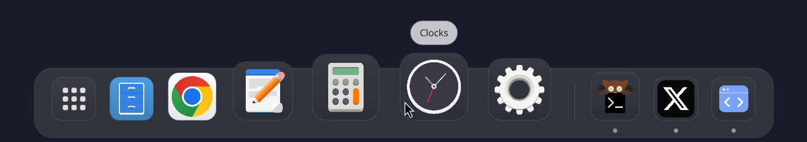
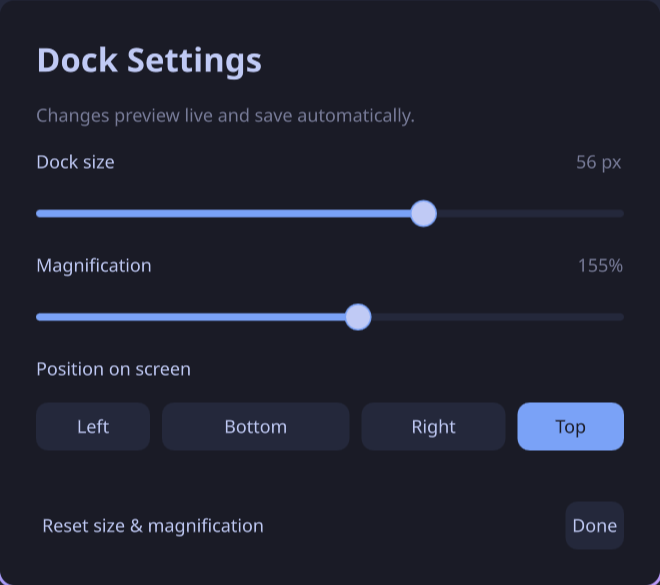

# Dock

A macOS-inspired application dock for Linux Wayland desktops. Built with
[Quickshell](https://quickshell.org/), Qt Quick, and Python.

[Demo](#in-motion) · [Installation](#installation) · [Compatibility](#compatibility) · [Usage](#usage) · [Configuration](#configuration) · [Contributing](#contributing)



## Why Dock?

Dock brings a familiar, mouse-friendly application switcher to Wayland: keep
favorites close, find running windows, and launch applications from one place.
It fits alongside a tiling or floating compositor without requiring a complete
desktop environment or somebody else's dotfiles.

- **Familiar interaction.** Smooth magnification, drag-to-pin, window previews,
  and a divider you can drag to resize the dock.
- **Independent configuration.** Its own settings and theme, with no dependency
  on Omarchy or Waybar.
- **Portable where Wayland allows it.** A generic protocol backend, with an
  optional Hyprland integration for workspace-aware behavior.

## In motion

[](docs/media/dock-demo-120fps.mp4?raw=true)

**[Watch or download the full 120 fps video](docs/media/dock-demo-120fps.mp4?raw=true)**
— 14 seconds, 2640 × 330, approximately 2.2 MB.
[Still frame](docs/media/dock-demo-poster.png).

Recorded from the real dock with 18 installed apps, including Herdr, Chrome,
Ghostty, Kitty, Signal, and GNOME applications. Slow hovers alternate with fast
accelerating sweeps, rapid reversals, and quick exits/re-entries—all in real time.
The inline preview is 60 fps;
the MP4 retains the 120 fps capture. Badge counts and progress are **demo data**
sent through the actual D-Bus interface, not real unread messages.

## Features

- Sine-warp magnification, smooth hover transitions, and launch animation.
- Pinned favorites followed by unpinned running applications.
- Drag-to-reorder and live resizing with automatic persistence.
- A persistent Trash icon after the divider, with live empty/full state.
- Window switching, preview cards, and close/restore actions.
- App-provided count badges, progress bars, and attention indicators.
- Searchable application launcher with keyboard navigation.
- All four screen edges, multi-monitor panels, and auto-hide.
- Editable colors, icon size, and magnification.
- Hyprland extras: workspace-aware switching, overlap hiding, and urgent-window indicators.



## Compatibility

**Dock is a Wayland application, not a universal desktop extension.** The
generic backend requires both `zwlr_layer_shell_v1` and
`zwlr_foreign_toplevel_manager_v1` from the compositor.

| Desktop / compositor | Status |
| --- | --- |
| **Hyprland** | Tested with the dedicated integration and generic Wayland backend |
| **Sway, labwc, Wayfire** | Protocol-compatible candidates; not yet runtime-tested by this project |
| **GNOME** | Not supported; requires a GNOME Shell extension |
| **Stock KDE Plasma** | Not currently supported; requires a Plasma window-management adapter |
| **X11 sessions** | Not supported |

Actual protocol support can vary with compositor version and configuration.

| Capability | Generic Wayland | Hyprland integration |
| --- | --- | --- |
| Launcher, favorites, magnification, resizing | Yes | Yes |
| Window listing, activation, closing | Yes | Yes |
| Multi-monitor panels and auto-hide | Yes | Yes |
| App-provided badges and progress | Yes | Yes |
| Minimize / restore | Native requests, if supported | Special-workspace implementation |
| Live window previews | Requires a supported capture protocol | Requires capture support |
| Workspace-aware switching | No | Yes |
| Hide when windows overlap | No | Yes |
| Native urgent-window indicators | No; app-provided attention still works | Yes |

Window-management requests may be ignored by the compositor. For example, Sway
does not provide conventional minimization. When window capture is unavailable,
preview cards fall back to application icons.

## Installation

### Omarchy quick install

Inside your Omarchy desktop session:

```sh
git clone --depth 1 https://github.com/penso/dock.git
cd dock
./install-omarchy.sh
```

This installs dependencies through Omarchy's package helper, builds and installs
the native **`dock-quickshell`** Arch package, and enables graphical-login
autostart. It disables Omarchy's built-in dock plugin when present; use
`--keep-omarchy-dock` to retain it. Classic/Lua Hyprland dispatchers are detected
automatically. See the [Omarchy installation guide](docs/omarchy.md) for updates,
removal, migration from a user-local install, and package publication status.

The package is not yet published in Omarchy's repository or the AUR. Until this
GitHub repository is public, cloning requires access to it. The generic per-user
installation for other compatible desktops follows below.

### 1. Install the prerequisites

- **Quickshell 0.3.2**, the tested version, with Wayland/toplevel and screencopy
  support. Follow the [Quickshell installation guide](https://quickshell.org/docs/guide/install-setup/)
  for your distribution.
- **Qt 6 QML modules:** QtQuick, QtQuick.Controls, QtQuick.Layouts, and
  QtQuick.Effects. These may be separate packages in your distribution.
- **Python 3.10+**, Git, and an installed icon theme.
- **For badges and progress:** session D-Bus and Python GObject/Gio bindings
  (`python3-gi` on Debian/Ubuntu; `python-gobject` on Arch).
- **For Trash:** GIO/GVfs with its trash backend and a file manager supporting
  `trash:///`. GNOME Adwaita icons and GdkPixbuf/librsvg provide distinct empty/full
  artwork with correct transparency. The Arch package installs these dependencies.
- **For the Hyprland integration:** Quickshell's Hyprland module and `hyprctl`
  available on `PATH`.

Dock's installer does not build Quickshell or install system packages. Older
Quickshell versions are unverified.

### 2. Install Dock for your user

```sh
git clone https://github.com/penso/dock.git
cd dock
python3 install.py
```

Run the installer as your normal user; **no `sudo` is needed**. It installs:

| Location | Contents |
| --- | --- |
| `~/.local/bin/dock` | Launcher |
| `$XDG_DATA_HOME/dock` | QML source and helpers |
| `$XDG_CONFIG_HOME/dock` | Settings and theme, created on first run |
| `$XDG_CONFIG_HOME/systemd/user/dock.service` | Optional user service |

If unset, `XDG_DATA_HOME` defaults to `~/.local/share` and `XDG_CONFIG_HOME`
defaults to `~/.config`. Existing settings and theme colors are preserved.

### 3. Launch in your Wayland session

For the generic Wayland backend:

```sh
DOCK_COMPOSITOR=wayland ~/.local/bin/dock
```

On Hyprland, the launcher detects the installed dispatcher syntax:

```sh
~/.local/bin/dock

# Optional explicit override for traditional dispatchers
DOCK_BACKEND=classic ~/.local/bin/dock
```

Without an override, Dock detects Hyprland from the session environment and
otherwise selects generic Wayland. It uses a read-only IPC query to distinguish
Lua from classic Hyprland dispatchers. The Lua integration was tested on a
Hyprland 0.56.0 development build; traditional dispatchers have unit coverage
but have not been runtime-tested on an older compositor.

Add `~/.local/bin` to your `PATH` to use the shorter `dock` command. To try the
checkout before installing, use `./bin/dock` with the same environment options.
Stop another dock first if it occupies the same screen edge.

### Autostart

Choose one autostart method and retain any backend options you used above.

**Sway** — add to your Sway configuration:

```ini
exec env DOCK_COMPOSITOR=wayland ~/.local/bin/dock
```

**Hyprland with traditional configuration/dispatchers:**

```ini
exec-once = ~/.local/bin/dock
```

**Hyprland with Lua configuration:**

```lua
hl.on("hyprland.start", function()
  hl.exec_cmd(os.getenv("HOME") .. "/.local/bin/dock")
end)
```

For other compatible sessions, add `~/.local/bin/dock` to their autostart facility.

<details>
<summary>Using the optional systemd user service</summary>

On Omarchy or another session that manages `graphical-session.target`, the
installed launcher can configure autostart and import the session environment:

```sh
dock enable
dock disable  # Stop and disable autostart
dock restart  # Restart after an update
```

Start the service from your graphical session after importing its environment:

```sh
systemctl --user daemon-reload
dbus-update-activation-environment --systemd WAYLAND_DISPLAY PATH

# In a Hyprland session, also run:
dbus-update-activation-environment --systemd HYPRLAND_INSTANCE_SIGNATURE

systemctl --user start dock.service
```

Import any custom `XDG_CONFIG_HOME`, `XDG_DATA_HOME`, or `DOCK_*` variables too,
or set them in a service override with `systemctl --user edit dock.service`:

```ini
[Service]
Environment=DOCK_BACKEND=classic
```

The generic Python installer creates the service but does not enable or start
it; the Omarchy setup script enables it. The service is tied to graphical sessions,
not non-graphical user logins.

</details>

### Update

For an Omarchy package install, follow [these update instructions](docs/omarchy.md#update-a-checkout-built-package).
For the per-user Python installation, run this from your checkout:


```sh
git pull --ff-only
python3 install.py
```

Restart Dock after updating. If you use the service:

```sh
systemctl --user daemon-reload
systemctl --user restart dock.service
```

### Uninstall

For an Omarchy package install, use `dock disable` followed by
`omarchy-pkg-drop dock-quickshell`; see [the Omarchy guide](docs/omarchy.md#remove).
For the per-user Python installation:

Stop Dock and remove its autostart entry. If using systemd, stop it with
`systemctl --user stop dock.service`. Then remove the installed files:

```sh
rm -f "$HOME/.local/bin/dock"
rm -rf "${XDG_DATA_HOME:-$HOME/.local/share}/dock"
rm -f "${XDG_CONFIG_HOME:-$HOME/.config}/systemd/user/dock.service"
```

Run `systemctl --user daemon-reload` if you used the service. Your settings in
`$XDG_CONFIG_HOME/dock` and your Git checkout are kept.

## Usage

The dock starts at the **bottom** of the screen. Its default icon size is
**40 px**, with **132%** hover magnification. Favorites start empty; running
applications appear automatically when the compositor exposes them.

| Action | Result |
| --- | --- |
| Click the launcher grid | Open application search |
| Right-click the launcher | Settings, position, and hide options |
| Click an app | Launch it, or switch between its windows |
| Middle-click an app | Request another launch |
| Right-click an app | Options, Show All Windows, Hide, and Quit; inactive apps offer Open |
| Drag an icon | Reorder favorites; drag a running app into favorites to pin it |
| Drag the divider toward the desktop | Enlarge the dock live |
| Drag the divider toward the screen edge | Shrink the dock live |
| Hover a running app | Show its window previews |
| Click Trash | Open the desktop's Trash folder |
| Right-click Trash | Open Trash or request “Empty Trash…” with confirmation |

The divider separates favorites from unpinned running apps and remains available
when that second group is empty. Resizing saves when you release it. For a bottom
dock, **up enlarges and down shrinks**.

App menus use compact, light popovers anchored to the selected icon. **Options →
Keep in Dock** controls pinning. **Show All Windows** opens the app's preview cards;
**Hide** requests minimization, and **Quit** sends normal close requests so apps can
prompt about unsaved work. Trash uses GNOME's empty/full artwork, rasterized into
the user's cache to preserve SVG transparency across Qt versions.

### Badges and notifications

Applications that implement the **Unity Launcher API** can publish unread counts,
progress, and attention requests. Counts above 99 display as **99+**; an amber
outline indicates attention. These app-provided updates work with both backends.

Support depends on the application: ordinary notification popups are **not**
counted as unread messages. Mako, Dunst, or your existing notification daemon
continues to handle popups. See [badge support and a live demo](docs/badges.md).

## Configuration

Edit `~/.config/dock/settings.json` and `~/.config/dock/theme.json`, or use Dock
Settings. Both files are watched live. See the [default settings](config/settings.json)
and [default theme](config/theme.json).

Favorites use desktop file names without the `.desktop` suffix. Missing apps
remain in settings but are hidden until installed.

```sh
dock ctl pin org.gnome.Nautilus
dock ctl position left
dock ctl appearance 48 150
dock ctl autohide on
dock ctl intellihide off

dock ipc apps
dock ipc settings
dock ipc status
dock ipc activate org.gnome.Nautilus
```

Bind `dock ipc minimize` to a shortcut or titlebar action; use `dock ipc restore`
to restore a minimized window. On Hyprland, minimization uses `special:minimized`.
The generic backend requests native minimization when available.

<details>
<summary>Environment overrides</summary>

| Variable | Purpose / default |
| --- | --- |
| `DOCK_CONFIG_DIR` | Settings directory; `$XDG_CONFIG_HOME/dock` |
| `DOCK_COMPOSITOR` | `auto`, `hyprland`, or `wayland` |
| `DOCK_BACKEND` | Hyprland dispatcher syntax: detected by default; override with `lua` or `classic` |
| `DOCK_HYPRCTL` | Hyprland executable; `hyprctl` |
| `DOCK_QUICKSHELL` | Quickshell executable; `quickshell` |
| `DOCK_DBUS_PYTHON` | Python with GObject/Gio; `/usr/bin/python3` |

</details>

## Troubleshooting

- **Dock does not appear:** run it from a terminal inside your Wayland session
  and inspect the output. Confirm your compositor provides both required protocols.
- **Hyprland window actions fail:** try an explicit `DOCK_BACKEND=classic` or
  `DOCK_BACKEND=lua`, or use `DOCK_COMPOSITOR=wayland`.
- **No unread badge:** the app must publish LauncherEntry updates. Check the
  `badges.ready` field in `dock ipc status` and install GObject/Gio if missing.
- **Previews show icons:** the compositor may not expose a compatible per-window
  capture protocol.
- **Overlap hiding is unavailable:** it currently requires the Hyprland backend.

For the service, inspect `journalctl --user -u dock.service`.

## Contributing

Reports from other compatible compositors are welcome. Include your compositor
and Quickshell versions, selected backend, reproduction steps, and relevant logs.
The generic backend has been exercised on Hyprland without using `hyprctl`;
testing on other desktops will help expand the compatibility table.

Run the tests from a checkout:

```sh
python3 -m unittest discover -s tests -v
node --test qml/tests/model.test.js
QT_QPA_PLATFORM=offscreen QT_QUICK_BACKEND=software \
  /usr/lib/qt6/bin/qmltestrunner -input qml/tests -o -,txt
```

QML tests need QtTest; the `qmltestrunner` path varies by distribution. The D-Bus
integration test needs system Python GObject and `dbus-run-session`, and runs on
an isolated bus. Core tests also run in [GitHub Actions](https://github.com/penso/dock/actions).

- [Compositor backend contract](docs/backends.md)
- [Animation model](docs/animation.md)
- [macOS Dock analysis notes](docs/apple-dock-analysis.md)
- [Badge protocol](docs/badges.md)
- [Omarchy packaging and release workflow](docs/omarchy.md)

Use `DOCK_CONFIG_DIR=/tmp/dock-dev ./bin/dock` for separate development settings.

## License

[MIT](LICENSE).
